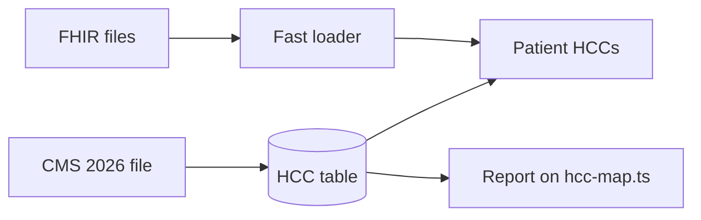

# metriport-hcc-2026

A tested 2026 table that links each diagnosis code (ICD-10) to its Medicare risk group (HCC) in every 2026 payment model.
It is built for Metriport's FHIR data and warehouse, and it comes with a faster FHIR file loader.

## Key results

- **231 codes are missing.** These codes pay under V28, the model CMS uses for most Medicare Advantage plans in 2026. But they are not in Metriport's public map (`hcc-map.ts`). **134** of them are brand new codes from Oct 1, 2025. Every code the map does have is correct.
- **23 HCC numbers mean different things.** The same number can point to a different condition in V24 and V28. For example, HCC 19 is diabetes in V24 but a cancer group in V28.
- **About 23x faster file reading.** The loader reads each FHIR file once, not 28 times. On the same 3 tables it is about 4x faster.
- **58,084 rows checked.** Every row of the table matches the official CMS 2026 file. 34 tests pass.




## How Metriport could use this

- **A ready table.** Its columns match the `condition_extension_vcc_coding` table, plus the model and the year. It could be loaded into the warehouse as is.
- **A model label.** Adding the model next to `condition.hcc_code` could show which payment model each HCC belongs to.
- **A yearly check.** The report could run against each new CMS file. The faster loader idea could also be tested in the fhir-to-csv step (`parseNdjsonBundle.py`).

## Quick start

You need Python 3.11 or newer, `make`, and internet access.

```
make all
```

This builds the table, runs the report and the speed test, and runs all tests. It takes about 4 minutes.

More detail, including the speed table, the checks and the limits, is in [docs/DETAILS.md](docs/DETAILS.md).

## About me

I am Asad Moulvi, a Data Scientist at DataQHealth (since June 2025, before that a Data Analyst).

- **CMS data.** I automated CMS data collection and ACO doctor selection. Our ACO was approved in under 3 months. That work led to the CMS table here.
- **Big pipelines.** I build healthcare data pipelines for claims, encounters (visits) and patient attribution (which doctor a patient belongs to). They process over 10M records a year. That led to the fast loader.
- **FHIR.** I built a FHIR-based AI scribe for doctors. That led to the careful FHIR reading here.
- **Clinical tools.** I built an AI tool that sums up heart device alerts. It saves nurses 3 hours a day and raised monitoring capacity by 25%. That taught me to check health data tools carefully.

MS in Business Analytics and AI (UT Dallas). BSc Physics (University of Nottingham).
[LinkedIn](https://www.linkedin.com/in/asad-moulvi-aaa278175) · [GitHub](https://github.com/WannaBeSolopreneur) · asad.moulvi01@gmail.com

---

Based on Metriport's public repo and docs as of Oct 30, 2026. If this is already fixed internally, this is a tested CMS 2026 table to check against.

**Credits:** HCC mappings and ICD-10 code lists from [CMS](https://www.cms.gov/medicare/payment/medicare-advantage-rates-statistics/risk-adjustment/2026-model-software-icd-10-mappings). All patient data is synthetic.

**License:** MIT, by Asad Moulvi. See [LICENSE](LICENSE).
