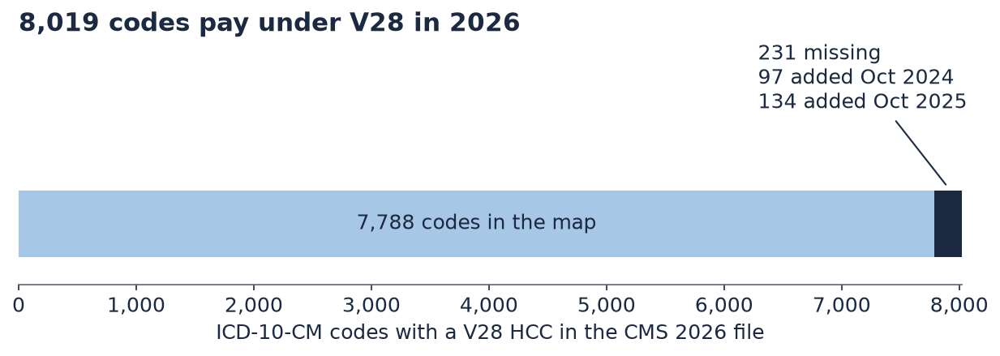
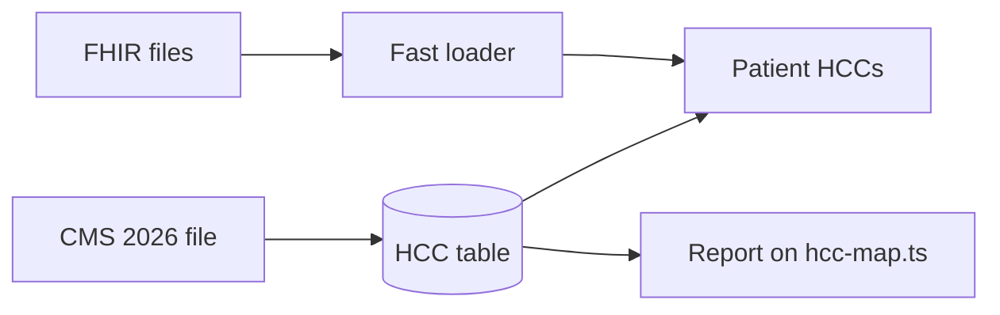

# metriport-hcc-2026

A tested 2026 table that links each diagnosis code (ICD-10-CM) to its Medicare risk group (HCC) in every 2026 payment model.
It is built for Metriport's FHIR data and warehouse, and it comes with a faster FHIR file loader.

## Key results

- **231 codes are missing.** These codes pay under V28, the model CMS uses for most Medicare Advantage plans in 2026. But they are not in Metriport's public map (`hcc-map.ts`). **134** of them are brand new codes from Oct 1, 2025.
- **The rest of the map holds up.** Codes still in the CMS 2026 file match on V28. Codes in the CMS 2025 file match on V24. 22 older parent codes are left over from code splits.
- **23 HCC numbers mean different things.** HCC 19 in V24 is mostly diabetes without complications, plus Z79.4 (long-term insulin use). In V28, HCC 19 is a cancer group.
- **About 4x faster loading.** On the same 3 tables, the loader is 3.9x faster than the current pattern. Against the whole pattern (28 passes, temp files and CSVs vs one pass to Parquet) it is 22.4x faster. This is synthetic data on one machine.
- **58,084 rows checked.** Every row matches the official CMS 2026 file. 42 tests pass.





## How Metriport could use this

- **A lookup table.** Join it on the ICD-10 code. In this table `code` is the ICD-10-CM code and `hcc_code` is the HCC. In `condition_extension_vcc_coding`, `code` is the HCC number. So map the columns, do not load it as is.
- **A model label.** Adding the model next to `condition.hcc_code` would show which payment model each HCC belongs to.
- **A yearly check.** The report could run against each new CMS file. The loader idea could also be tried in the fhir-to-csv step (`parseNdjsonBundle.py`).

## Quick start

You need Python 3.11 or newer, `make`, and internet access.

```
make all
```

This builds the table, runs the report, recounts the numbers with a separate script, runs the speed test and runs all tests. It takes about 4 minutes.

More detail, including the speed table, the checks and the limits, is in [docs/DETAILS.md](docs/DETAILS.md).

## About me

I am Asad Moulvi, a Data Scientist at DataQHealth (since June 2025, before that a Data Analyst).

- **CMS data.** I automated CMS data collection and ACO doctor selection. Our ACO was approved in under 3 months.
- **Pipelines and FHIR.** I build healthcare pipelines for claims, encounters and patient attribution, over 10M records a year. I also built a FHIR-based AI scribe for doctors.
- **Clinical tools.** I built an AI tool that sums up heart device alerts. It saves nurses 3 hours a day.

MS in Business Analytics and AI (UT Dallas). BSc Physics (University of Nottingham).
[LinkedIn](https://www.linkedin.com/in/asad-moulvi-aaa278175) · [GitHub](https://github.com/WannaBeSolopreneur) · asad.moulvi01@gmail.com

---

Based on Metriport's public repo and docs as of Oct 30, 2026. If this is already fixed internally, this is a tested CMS 2026 table to check against.

**Credits:** HCC mappings and ICD-10 code lists from [CMS](https://www.cms.gov/medicare/payment/medicare-advantage-rates-statistics/risk-adjustment/2026-model-software-icd-10-mappings). All patient data is synthetic.

**License:** MIT, by Asad Moulvi. See [LICENSE](LICENSE).
