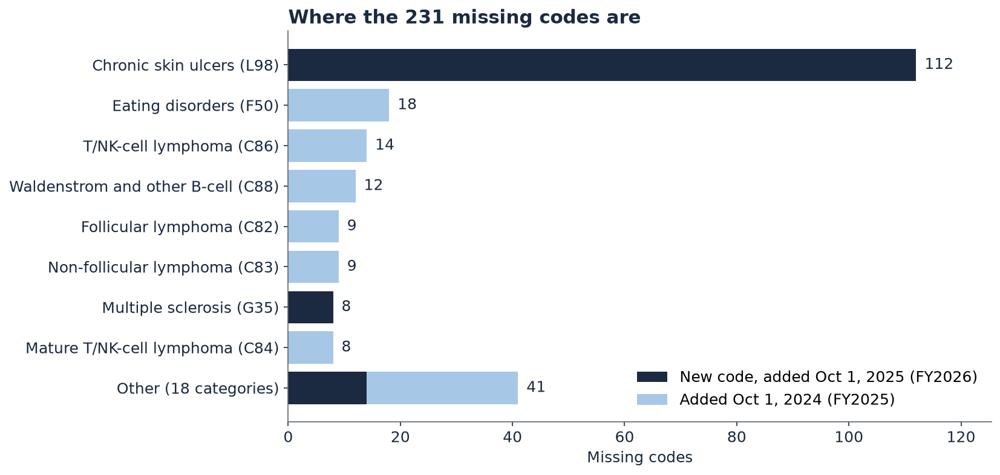
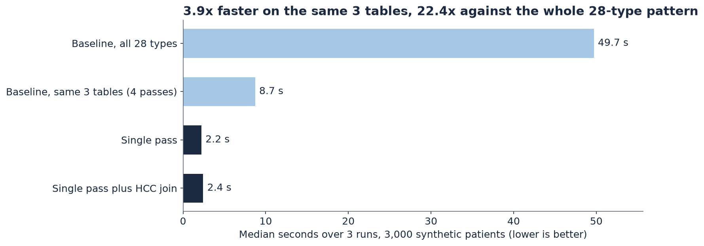
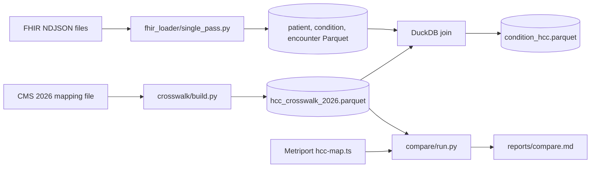

# Details

This page has the full details behind the [README](../README.md).

## Contents

1. [Metriport context](#metriport-context)
2. [Why it matters in 2026](#why-it-matters-in-2026)
3. [Key results](#key-results)
4. [How it works](#how-it-works)
5. [Quick start](#quick-start)
6. [Query it with DuckDB](#query-it-with-duckdb)
7. [How it was verified](#how-it-was-verified)
8. [Limits](#limits)

## Metriport context

- Metriport turns patient data from many sources into one FHIR record. Customers can sync it to a data warehouse.
- Metriport's analytics flag suspected and under-coded conditions to help risk adjustment.
- Its FHIR HCC extension (system `http://terminology.hl7.org/CodeSystem/cmshcc`) labels each HCC coding as `v24` or `v28`.
- The warehouse docs show one `condition.hcc_code` column and a `condition_extension_vcc_coding` table (`code`, `display`, `system`, `code_rank`). Neither has a model or version column.
- In the public code, Condition normalization adds HCC extensions from `hcc-map.ts`. A code that is not in the map gets no HCC extension.
- The fhir-to-csv step (`parseNdjsonBundle.py`) turns FHIR NDJSON files into tables.

Based on Metriport's public repo and docs as of Oct 30, 2026. Their internal version may already be newer.

## Why it matters in 2026

- In 2026, CMS pays non-PACE Medicare Advantage plans on the V28 model at 100%.
- PACE plans use 10% V28 and 90% V22.
- ESRD members use their own models (V24 categories, plus V21 for PACE).
- Part D uses RxHCC V08.

So one ICD-10 code can have a different HCC in each model.
An HCC number on its own does not say which model it belongs to.
This table puts the model name next to every HCC.

The same HCC number can mean very different things in V24 and V28:

| HCC number | In V24 it means | In V28 it means |
|---:|---|---|
| 19 | Diabetes without complication (for example E08.9) | A cancer group (for example C45.0, mesothelioma) |

Type 2 diabetes (E11.9) is HCC 19 in V24 and HCC 38 in V28.
In Metriport's map, 26 HCC numbers are used by both versions. 23 of them share no codes at all.

## Key results

### 1. A tested 2026 table

- 58,084 rows covering 11,346 ICD-10-CM codes, built from the official CMS 2026 file.
- One row per code, payment model and HCC.
- Models: `CMS-HCC-V28`, `CMS-HCC-V22`, `ESRD-V24`, `ESRD-V21` and `RxHCC-V08`.
- Columns: `code, display, system, hcc_code, hcc_model, payment_year, payment_flag`.
  These are close to Metriport's `condition_extension_vcc_coding` columns, plus the model and the year.
- A code with no HCC in a model gets a row with an empty `hcc_code` and `payment_flag = false`. So "no HCC" is clear, not just missing.

Files: [`data/hcc_crosswalk_2026.csv`](../data/hcc_crosswalk_2026.csv) and `data/hcc_crosswalk_2026.parquet`.

### 2. Compared with Metriport's public map

Metriport's public map (`hcc-map.ts`) is accurate for every code it has.
Every V28 value matches CMS 2026, and every V24 value matches CMS 2025.
The gap is newer codes.


- CMS 2026 gives a V28 HCC to **8,019** codes. **231** of them are not in the public map.
- **134** are brand new codes from Oct 1, 2025 (FY2026). One example is C50.A0 to C50.A2, inflammatory breast cancer, V28 HCC 23.
- The other **97** were added on Oct 1, 2024 (FY2025). Examples are E66.813 (obesity class 3, HCC 48) and C81.0A (Hodgkin lymphoma in remission, HCC 21).



Most of them are chronic skin ulcer codes (112), followed by eating disorders and lymphomas.

There is one more small finding.
**22** codes in the map still carry a V28 HCC, but they are not valid codes in FY2025 or FY2026.
They are older parent codes that were split into more specific codes.
Examples are C86.0 to C86.6, C88.0 to C88.9, G20 (Parkinson's) and I24.8.
For 18 of them, the new specific codes they were split into are among the 231 missing codes.

Full details: [`reports/compare.md`](../reports/compare.md), [`reports/missing_v28_codes.csv`](../reports/missing_v28_codes.csv) and [`reports/split_parent_codes.csv`](../reports/split_parent_codes.csv).

### 3. A faster FHIR loader

Metriport's public `parseNdjsonBundle.py` reads each patient file 28 times, once per resource type.
This loader reads each file once.



On 3,000 synthetic patients, median of 3 runs:

| Approach | Median seconds |
|---|---:|
| Baseline, 28 passes per file | 49.2 |
| Baseline, same 3 tables only (4 passes per file) | 8.5 |
| Single pass to Parquet | 2.2 |
| Single pass to Parquet, plus the DuckDB HCC join | 2.6 |

- It is **about 23x faster at reading the files** (28 passes vs 1).
- In a fair test on the same 3 tables, it is **about 4x faster**.
- Both give exactly the same rows. The benchmark stops with an error if they ever differ.
- The whole benchmark was run 3 times. The speedup came out at 22.4x, 23.5x and 22.9x. On the same 3 tables it was 3.8x, 3.9x and 4.0x. The table shows the last run.

These are synthetic files on one machine. Treat them as a direction, not a production estimate.
Details: [`reports/benchmark.md`](../reports/benchmark.md).

## How it works



- **Crosswalk.** `crosswalk/` downloads the CMS 2026 file, checks its sha256, and builds the table.
- **Compare.** `compare/` reads Metriport's public map at a pinned commit and the official ICD-10-CM code lists, then writes the reports.
- **Loader.** `fhir_loader/` reads each NDJSON file once and writes Parquet in batches, so memory stays flat.
  - Conditions get **one row per ICD-10 coding**, like Metriport's `config_Condition_code_coding.ini`. So I10 plus E11.9 on one Condition gives two rows, and E11.9 still maps to V28 HCC 38.
  - It accepts the system names `http://hl7.org/fhir/sid/icd-10-cm`, `urn:oid:2.16.840.1.113883.6.90` and `http://hl7.org/fhir/sid/icd-10`.
  - It cleans codes before the join. `" e11.9 "` becomes `E119`. The original code is kept in `icd10_code`.
  - It reads bundle entries (`{"resource": ...}`) and plain resource lines. It removes byte order marks.
  - Nothing is dropped silently. A Condition with no ICD-10 code is kept with an empty code. Bad lines are skipped, counted and logged as warnings.

## Quick start

You need Python 3.11 or newer, `make`, and internet access to cms.gov and GitHub.

```
make all
```

This takes about 4 minutes. It:

1. creates `.venv` and installs the tools,
2. builds the crosswalk,
3. runs the comparison,
4. runs the benchmark on 3,000 synthetic patients,
5. draws the charts in `docs/img/`,
6. prints a DuckDB demo,
7. runs ruff and pytest.

Each step also runs on its own: `make crosswalk`, `make compare`, `make bench`, `make charts`, `make test`.

Every download is checked against a pinned sha256.

## Query it with DuckDB

Which 2026 models pay for these codes?

```sql
SELECT code, display, hcc_model, hcc_code
FROM 'data/hcc_crosswalk_2026.parquet'
WHERE code IN ('E119', 'I739', 'C50A0') AND payment_flag
ORDER BY code, hcc_model
```

```
code   display                                                hcc_model    hcc_code
C50A0  Malignant inflammatory neoplasm of unspecified breast  CMS-HCC-V22  12
C50A0  Malignant inflammatory neoplasm of unspecified breast  CMS-HCC-V28  23
C50A0  Malignant inflammatory neoplasm of unspecified breast  ESRD-V21     12
C50A0  Malignant inflammatory neoplasm of unspecified breast  ESRD-V24     12
C50A0  Malignant inflammatory neoplasm of unspecified breast  RxHCC-V08    22
E119   Type 2 diabetes mellitus without complications         CMS-HCC-V22  19
E119   Type 2 diabetes mellitus without complications         CMS-HCC-V28  38
E119   Type 2 diabetes mellitus without complications         ESRD-V21     19
E119   Type 2 diabetes mellitus without complications         ESRD-V24     19
E119   Type 2 diabetes mellitus without complications         RxHCC-V08    31
I739   Peripheral vascular disease, unspecified               CMS-HCC-V22  108
I739   Peripheral vascular disease, unspecified               ESRD-V21     108
I739   Peripheral vascular disease, unspecified               ESRD-V24     108
```

I73.9 has no V28 row. So it adds nothing to a 2026 non-PACE Medicare Advantage score. It still counts for PACE and ESRD.

Count V28 HCCs per patient, after `make bench`:

```sql
SELECT patient_id, count(DISTINCT hcc_code) AS v28_hccs
FROM '.cache/bench/single/condition_hcc.parquet'
WHERE hcc_model = 'CMS-HCC-V28'
GROUP BY patient_id
ORDER BY v28_hccs DESC
LIMIT 5
```

## How it was verified

Three separate checks were run.

1. **An independent recount.** A separate script, written from scratch without this repo's code, recounted the results from the raw CMS files and Metriport's map. It got the same 231 missing codes, the same 134 new ones, and the same 23 HCC numbers that change meaning.
2. **Every row checked.** All 58,084 crosswalk rows were matched against the CMS 2026 file. They all match. A test (`tests/test_crosswalk.py`) does this on every run.
3. **Spot checks.** 25 codes, 20 picked at random plus C50A0, E66813, C810A, I10 and Z992, were checked one by one against the CMS file. C50A0 was confirmed as a new FY2026 code in the official ICD-10-CM addenda.

The tests also check that:

- the single pass loader and the baseline give exactly the same rows, on clean and messy data,
- messy input is handled: two codings on one Condition, OID and `icd-10` system names, dotted, lowercase and spaced codes, byte order marks, non-object lines, plain unwrapped NDJSON and missing fields,
- the reports are the same every time they are built.

## Limits

- The loader only builds Patient, Condition and Encounter tables.
- The synthetic data is shaped like Metriport's output, but it is not real data. Real files differ in size and shape.
- The benchmark runs on one machine, in one process.
- The comparison uses Metriport's **public** repo and docs. Their internal version may already be newer.
- This table maps codes to HCCs. It does not compute risk scores. Scores also need demographics, hierarchies and coefficients.

